# Emberwake art

Generated by `node tools/export_art.js` (runs automatically with `python build.py`). Don't edit these files by hand. Change the sprite or animation in `src/content/` and rebuild.

## Enemy animations

Defined by `anim:` in each file in `src/content/enemies/`.

| | | | | | |
|---|---|---|---|---|---|
|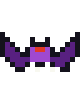 **bat** 3 frames @ 10 fps| **bogking** 2 frames @ 5 fps| **cinderling** 4 frames @ 6 fps| **frog** 2 frames @ 5 fps| **frog_poison** 2 frames @ 5 fps| **frostling** 4 frames @ 6 fps|
| **ghost** 4 frames @ 4 fps| **hearth_fire** 4 frames @ 4 fps| **hearth_frost** 4 frames @ 4 fps| **hearth_hollow** 4 frames @ 4 fps| **king** 2 frames @ 2 fps| **knight** 4 frames @ 4 fps|
| **magmite** 3 frames @ 3 fps| **matriarch** 4 frames @ 4 fps| **orb** 4 frames @ 5 fps| **patriarch** 4 frames @ 4 fps|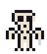 **skeleton** 4 frames @ 5 fps|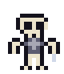 **skeleton_a1** 4 frames @ 5 fps|
|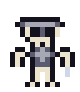 **skeleton_a2** 4 frames @ 5 fps|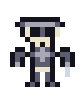 **skeleton_a3** 4 frames @ 5 fps| **slime** 4 frames @ 6 fps| **snowwolf** 4 frames @ 8 fps| **spider** 3 frames @ 9 fps| **spitter** 4 frames @ 6 fps|
|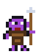 **thornling** 4 frames @ 6 fps|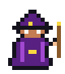 **wizard** 3 frames @ 3 fps| **wyrm** 3 frames @ 3 fps| **wyrm_frost** 3 frames @ 3 fps| **wyrm_hollow** 3 frames @ 3 fps||

## Other animations

Defined with `defineAnim(...)` in `src/content/sprites/`.

| | | | | | |
|---|---|---|---|---|---|
|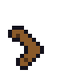 **boomerang_spin** 8 frames @ 20 fps| **disc_spin** 8 frames @ 20 fps|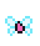 **fairy** 2 frames @ 12 fps| **flame** 3 frames @ 8 fps|||

## Hero run cycle

Poses in `RUN_FRONT` / `RUN_SIDE`, order in `RUN_SEQ`, squash in `RUN_SCALE` (`src/content/sprites/heroes.js`).

| | | | | | |
|---|---|---|---|---|---|
| **sword front cloth** A B C B, 9 fps| **sword front chain** A B C B, 9 fps|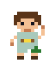 **sword front plate** A B C B, 9 fps|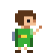 **sword side cloth** A B C B, 9 fps| **sword side chain** A B C B, 9 fps|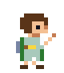 **sword side plate** A B C B, 9 fps|
| **sword back cloth** A B C B, 9 fps| **sword back chain** A B C B, 9 fps| **sword back plate** A B C B, 9 fps| **monk front** A B C B, 9 fps|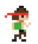 **monk side** A B C B, 9 fps| **monk back** A B C B, 9 fps|

## All sprites

Every `defineSprite` / `defineSpriteVariant`, as drawn.

| | | | | | |
|---|---|---|---|---|---|
| **armor**|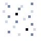 **armorbits**|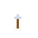 **arrow**|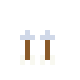 **arrow2**| **arrow2_ice**|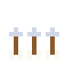 **arrow3**|
| **arrow3_ice**|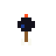 **arrow_bomb**| **arrow_ice**| **arrow_silver**|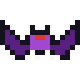 **bat**| **beam**|
| **beam_dawn**| **bogking**|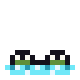 **bogking_sub**| **bomb**| **bonepile**| **boom**|
|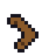 **boomerang**| **boomerang_spin**| **boots**|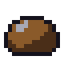 **boulder**|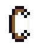 **bow**|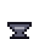 **brazier**|
| **bubble**| **bubble_p**| **bush**| **cactus**| **candle**| **cinderling**|
| **compass**| **coral**| **crystal**| **dawnblade**|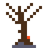 **deadtree**| **disc**|
| **disc_spin**| **dragonbell**| **drake_body_fire**| **drake_body_hearth**| **drake_body_hollow**| **drake_body_ice**|
| **drake_head_fire**| **drake_head_hollow**| **drake_head_ice**| **drake_neck_fire**| **drake_neck_hollow**| **drake_neck_ice**|
| **emberheart**| **fairy**| **fang**| **fireball**| **flame**| **frog**|
| **frog_poison**| **frog_poison_sub**|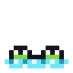 **frog_sub**| **frostling**|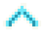 **galecloak**| **gem**|
| **gem_b**| **gem_g**| **gem_r**|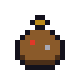 **gembag**| **ghost**| **gourd**|
| **grave**| **hcont**| **heart**| **hearth_fire**| **hearth_frost**| **hearth_hollow**|
| **hero_back**| **hero_front**|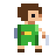 **hero_side**| **hpiece**| **icebolt**| **icefx**|
| **key**| **ki**|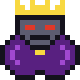 **king**| **knight**| **knight_back**| **magic**|
| **magmite**|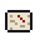 **map**| **master**| **matriarch**| **merchant**| **monk_back**|
|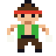 **monk_front**|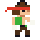 **monk_side**| **oldman**| **oldman_fire**| **oldman_frost**| **orb**|
| **patriarch**| **pedestal**| **pine**| **potion**| **puff**| **quiver**|
|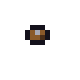 **rock**|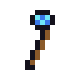 **rod**| **scroll**| **shard**| **sign**|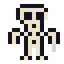 **skeleton**|
|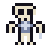 **skeleton_a1**|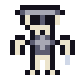 **skeleton_a2**|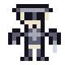 **skeleton_a3**| **skelkey**| **slag**| **slime**|
|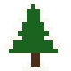 **snowpine**| **snowwolf**| **spider**| **spitter**| **statue**|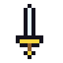 **sword**|
|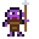 **thornling**| **tree**| **warpstone**| **wizard**| **wyrm**| **wyrm_frost**|
| **wyrm_hollow**||||||

